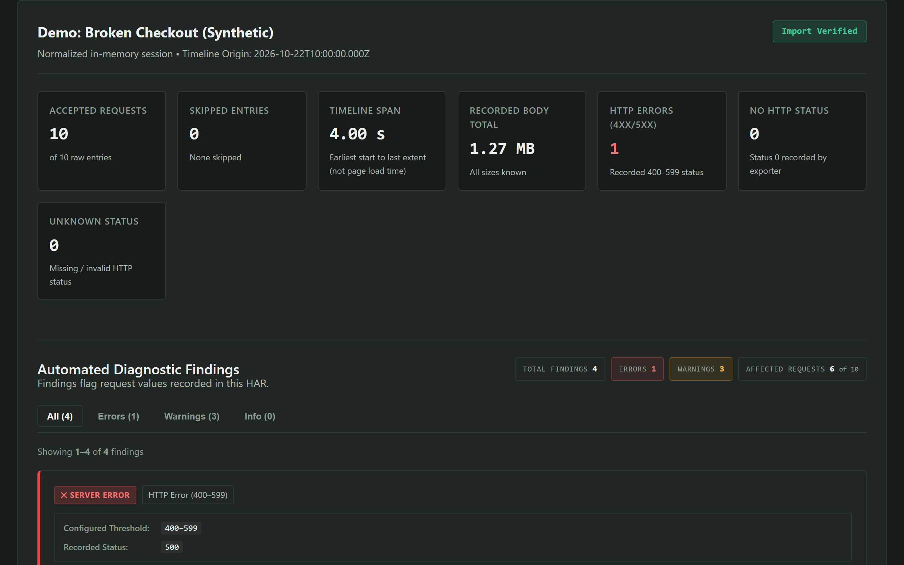
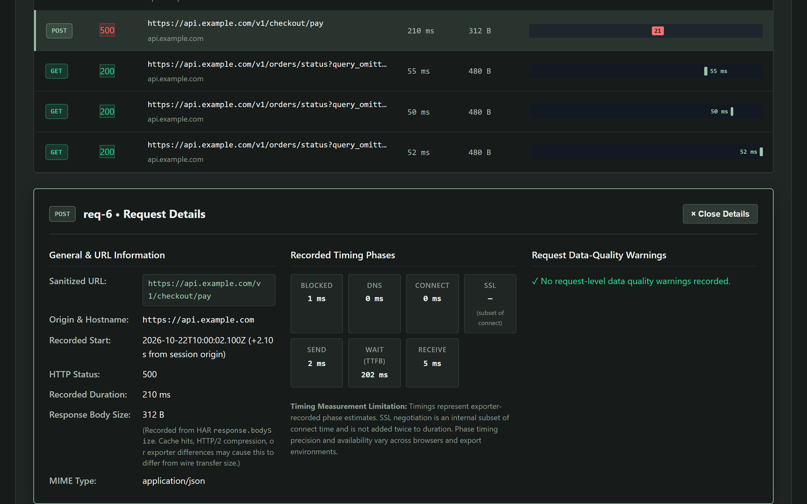
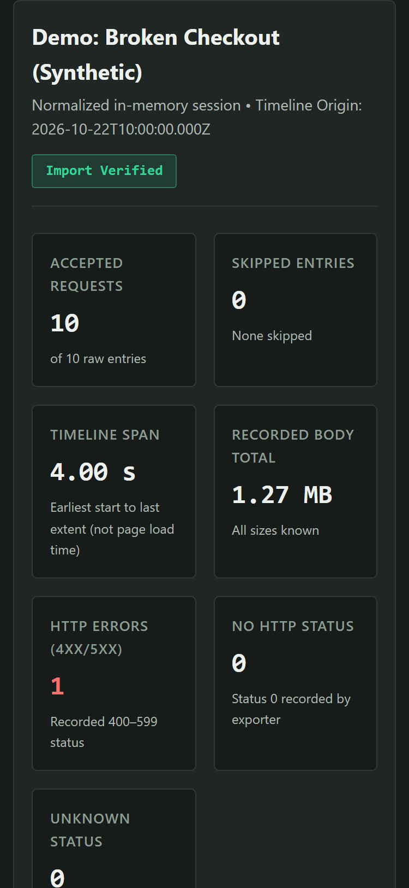

# HAR Inspector

A local browser dashboard for investigating HTTP Archive (HAR) recordings. Find failed requests, slow responses, large bodies, and repeated GET calls, then inspect the recorded evidence in a request table and waterfall.



## Run locally

Install Node.js 24 or newer and npm. Download this repository using **Code → Download ZIP** and extract it, or clone it with Git. Open a terminal in the extracted project folder (the folder containing `package.json`), then run:

```sh
npm ci
npm run dev
```

Open the address printed in the terminal, usually `http://localhost:5173`. HAR files are processed in your browser. Press Ctrl+C to stop the development server.

## Investigate a recording

1. Load **Broken Checkout** to explore a synthetic example, or import your own `.har` or HAR-formatted `.json` file.
2. Review the request totals and diagnostic findings.
3. Select a finding's evidence action to locate the relevant request. Conflicting table filters are cleared automatically.
4. Inspect status, duration, size, and phase timings. Use search, filters, sorting, and pagination to narrow the request list.
5. Reset the session to clear the active recording.

The clean example shows what the dashboard looks like when none of the rules match. For export steps, open **Export help** in the app.

## Privacy and limits

Imports are held in memory. The app does not upload recordings, replay requests, fetch recorded URLs, or save sessions to browser storage. Reloading clears the session.

The displayed recording omits headers, cookies, bodies, URL credentials, fragments, and query values. Hostnames and paths remain visible and may contain sensitive data. Use synthetic or reviewed recordings when filing issues.

- Maximum file size: 10 MiB.
- Maximum raw entries: 2,000, before invalid entries are filtered.
- One recording at a time; no live capture or session comparison.
- Chromium is verified. Firefox and Safari/WebKit remain unverified.

## Diagnostic rules

| Rule | Recorded trigger |
|---|---|
| HTTP error | Status 400–599 |
| Missing HTTP status | Status 0 |
| Long request | Duration at least 1,000 ms |
| Large body | Recorded `response.bodySize` at least 1 MiB |
| Repeated GET | At least three GET calls to the same endpoint within 2,000 ms |

The rules flag values recorded in the HAR. Missing timings and sizes appear as unknown. Thresholds are defined in `src/domain/types.ts`.

## Development

React, TypeScript, Vite, and plain CSS. Parsing, exploration, and diagnostics live in `src/domain/`; UI components live in `src/components/`. Bundled recordings and generated test captures are synthetic.

```sh
npm run typecheck
npm test
npm run build
npx playwright install chromium
npm run test:e2e
```

Browser tests cover imports, evidence navigation, filters, keyboard handling, mobile layout, local processing, and a 2,000-entry recording.

For a local production preview, run `npm run build` then `npm run preview`. Build output is written to `dist/`. The build includes the project's `LICENSE` and `THIRD_PARTY_NOTICES.txt`. Keep both files with the compiled app when distributing it.

To regenerate the test captures or refresh the README screenshots, run the relevant command below.

```sh
npm run fixtures:generate
npm run screenshots:capture
```

Browser test captures are generated automatically before `npm run test:e2e`; the generated `test-files/` directory is excluded from Git. Screenshot capture requires the development server at `http://127.0.0.1:5173`. Set `APP_URL` to use a different preview address.

## Screenshots

| Request evidence | Mobile layout |
|---|---|
|  |  |

## Contributing

See the contribution guide for issue reports and pull requests. [CONTRIBUTING.md](CONTRIBUTING.md)

## License

[MIT](LICENSE). Copyright 2026 Wadee Kharbat.
